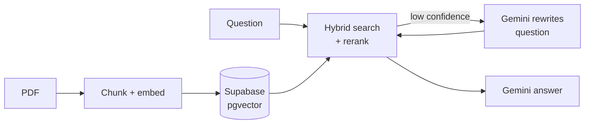
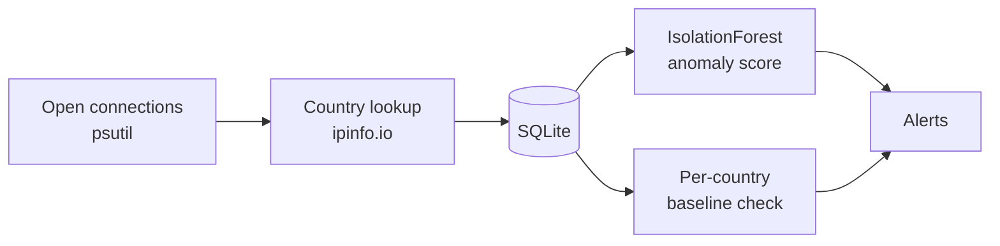

# Projects

Things I've built outside work, mostly to understand how something actually works instead of just reading about it.

---

## Hybrid RAG with LangGraph

  

A retrieval-augmented generation pipeline built from scratch. It reads a PDF, stores embedded chunks in Supabase, and answers questions using hybrid search, a LangGraph retry loop and Gemini.

**Stack:** Python, Supabase (pgvector), sentence-transformers, LangGraph, Gemini, Streamlit

---

## Outbound Traffic Monitor

  

A Python tool that logs which processes on my machine connect to which countries, then flags unusual traffic with an anomaly model and per-country baselines.

**Stack:** Python, psutil, scikit-learn, SQLite, matplotlib

