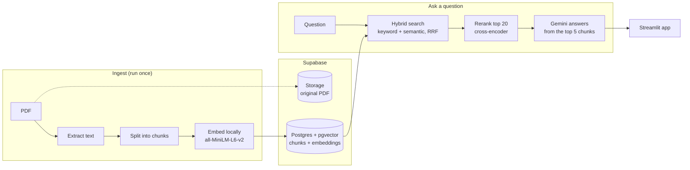
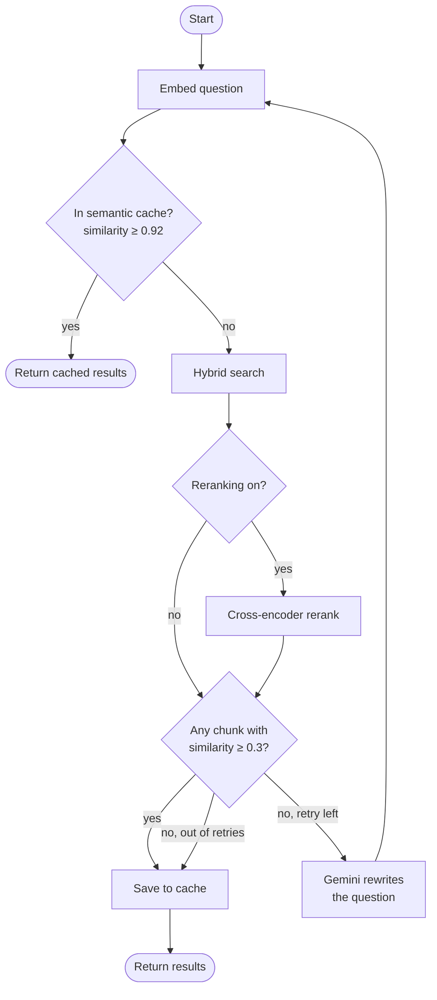
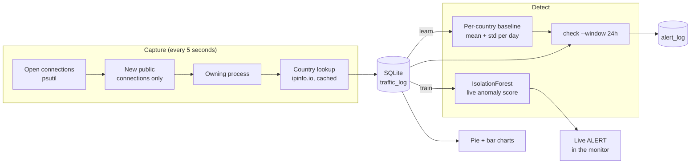
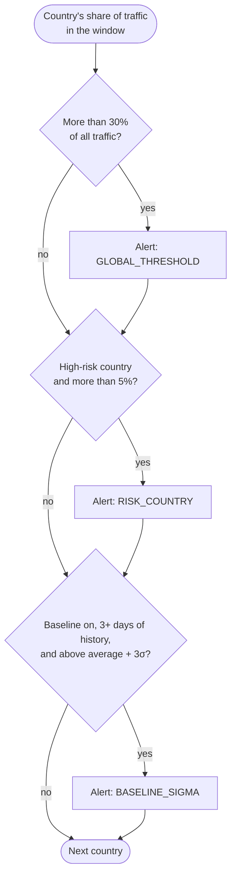

# Projects

Things I've built outside work, mostly to understand how something actually works instead of just reading about it.

---

## Hybrid RAG with LangGraph

  

A retrieval-augmented generation pipeline I built from scratch to learn what's really going on under the hood. It reads a PDF, splits it into chunks, embeds them, stores everything in Supabase, and answers questions about the document through a small Streamlit app. Fittingly, the PDF I tested it on is a book about building LLMs.

**Stack:** Python, Supabase (Postgres + pgvector + Storage), sentence-transformers, LangGraph, Gemini, Streamlit

### How it works

1. **Ingest:** extract text from the PDF, chunk it, and embed each chunk locally with `all-MiniLM-L6-v2` (384 dimensions).
2. **Hybrid search:** run a keyword search (Postgres full-text) and a semantic search (pgvector cosine) side by side, then merge the two ranked lists with Reciprocal Rank Fusion.
3. **Rerank (optional):** pull 20 candidates and rescore each question/chunk pair with a cross-encoder, keeping the best 5.
4. **Self-correcting retrieval:** a LangGraph state machine checks the results. If nothing comes back with enough confidence, Gemini rewrites the question and it tries once more.
5. **Answer:** Gemini answers the question using only the retrieved chunks.

### The LangGraph retry loop

Instead of returning nothing when the first search goes badly, the search runs as a small state machine. A cached answer skips everything, and a low-confidence result gets one rewrite and a second try.

### Things I learned along the way

- **Embeddings are bad at exact tokens.** Acronyms, error codes and version numbers often get missed by semantic search, which is why the keyword half of hybrid search matters.
- **"RAG" and "retrieval-augmented generation" are not the same to an embedding model.** They scored a similarity of just 0.13, while a genuine paraphrase scored 0.95. My semantic cache uses a 0.92 threshold, so it catches rewording but won't treat an acronym as its spelled-out form.
- **Local embeddings beat a free API tier.** I started with Gemini's embedding API, hit the rate limit within a handful of requests, and switched to sentence-transformers. No key and no waiting.
- **Tell the model to stick to the context.** Without that instruction it mixes in what it already "knows", which quietly defeats the point of RAG.
- **Searching is free, answering costs money.** Retrieval runs locally, and generating an answer is a separate button so only that step spends an API call.

---

## Outbound Traffic Monitor

  

A small Python tool that watches which processes on my machine talk to the internet, works out which country each connection goes to, and flags anything that looks unusual. Everything stays local in a SQLite file.

**Stack:** Python, psutil, scikit-learn (IsolationForest), SQLite, ipinfo.io, matplotlib

### How it works

1. **Capture:** every 5 seconds, list the established connections to public IPs, find the owning process, and look up the remote IP's country. Each connection is logged once when it opens, and loopback and LAN traffic is skipped.
2. **Risk flag:** connections to a small set of high-risk countries (CN, RU, IR, KP) get a flag.
3. **Live anomaly scoring:** after `train`, an IsolationForest scores every new connection and the monitor prints an alert for anything unusual.
4. **Baseline checks:** `learn` works out each country's normal daily share of traffic, and `check` compares a time window against it and writes any breaches to an alert table.
5. **Charts:** pie and bar charts of connections per country.

### How a check decides

Every country seen in the time window goes through three rules. Any rule that fires is recorded as an alert.

All three limits are command-line options (`--global-thresh`, `--risk-thresh`, `--sigma`).

### Things I learned fixing it

- **Log a connection once, not on every poll.** Re-logging open connections every 5 seconds made long-lived connections dominate the country percentages.
- **Don't send LAN traffic to a geo API.** Skipping private IPs and caching lookups keeps the free ipinfo.io limit from running out within minutes.
- **Processes disappear mid-scan.** A process can exit between listing connections and asking for its name, so that case has to be handled or the monitor crashes.
- **One place for file paths.** Three scripts had worked out three different database locations, so the CLI was quietly reading an empty database.
- **Don't hide failures.** Lookup errors used to be swallowed silently. Now they're logged as warnings, so `??` in the data has a visible reason.
