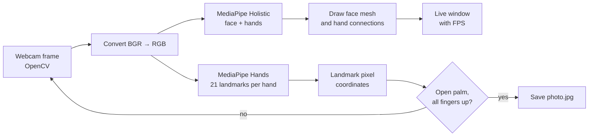
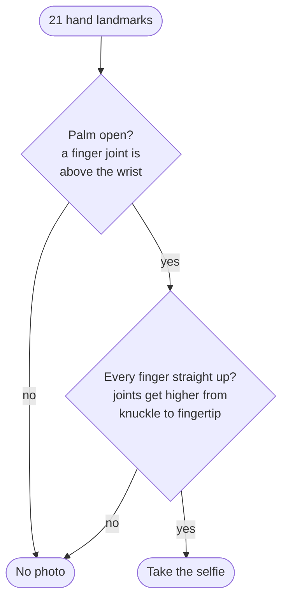

# Holistic Selfie with Gestures

  

Two small computer-vision experiments using a webcam. The first draws MediaPipe's holistic model live, with the face mesh and both hands traced over the video. The second takes a selfie when you hold up an open palm, so you don't need to touch the keyboard.

**Stack:** Python, OpenCV, MediaPipe (Holistic + Hands)

## How it works

1. **Capture:** read frames from the webcam with OpenCV and convert them to RGB for MediaPipe.
2. **Holistic model:** MediaPipe Holistic finds the face and both hands. The face contours and hand connections are drawn over the frame with an FPS counter.
3. **Hand landmarks:** MediaPipe Hands returns 21 points per hand (wrist, then 4 joints for each finger), converted into pixel coordinates.
4. **Gesture check:** if the hand is open and every finger points up, the current frame is saved as `photo.jpg`. Press `q` to quit.

## How the gesture is detected

Image coordinates grow downwards, so "higher on screen" means a smaller y value. The selfie fires only when both checks pass.

- **Palm open:** compares the wrist with one joint on each finger (landmarks 3, 6, 10, 14 and 19). At least one has to be above the wrist.
- **Fingers up:** for the thumb and each finger, the 4 joints have to rise steadily from knuckle to fingertip. A bent finger breaks the sequence, so a fist or a half-closed hand doesn't trigger a photo.
